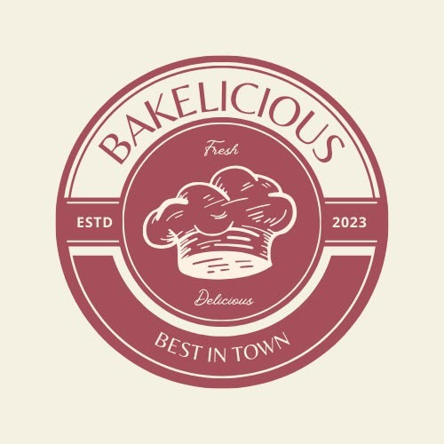

# Bakelicious - Bakery Business Management Website
> *Website for my Cake Business. (A Little Sass in Every Slice)*

Bakelicious is a full-stack, internal business-management ERP web application built specifically for bakery owners to manage products, categories, customer orders, production schedules, delivery calendars, raw material inventory, expenses, automated recipe costing, profit analytics, and downloadable PDF/CSV reports.



## Technology Stack

- **Frontend:** Next.js 14 (App Router), React 18, TypeScript, Tailwind CSS, Recharts, FullCalendar, Lucide React, Axios.
- **Backend:** Python 3.10+, FastAPI, SQLAlchemy 2.0 ORM, Pydantic v2, Alembic, JWT Authentication, Passlib/Bcrypt, ReportLab (PDF Generation).
- **Database:** SQLite for local development (`bakelicious.db`), PostgreSQL deployment-ready via `DATABASE_URL`.
- **Storage:** Local file system upload (`uploads/`) with cloud storage abstraction interface (Supabase Storage compatible).

---

## Quick Start (Local Development)

### 1. Backend Setup

```bash
cd backend
python -m venv venv
# On Windows:
venv\Scripts\activate
# On Linux/macOS:
source venv/bin/activate

pip install -r requirements.txt
python seed.py
uvicorn app.main:app --reload --port 8000
```

FastAPI server runs at `http://localhost:8000`. Interactive API Docs are available at `http://localhost:8000/docs`.

### 2. Frontend Setup

```bash
cd frontend
npm install
npm run dev
```

Next.js web application runs at `http://localhost:3000`.

---

## Admin Credentials

- **Email:** `admin@bakelicious.com`
- **Password:** `admin123`

---

## Key Features

1. **Dashboard:** Live financial metrics (Today's Revenue, Monthly Profit, Active Orders, Low Stock Alerts) and Recharts sales curves.
2. **Menu CMS:** Complete product & category management, dynamic price updates, image uploads with live preview, and automated recipe ingredient cost calculations.
3. **Order Lifecycle:** Multi-item customer order creation, discount and advance payment calculation, and status workflow transitions (`Received` $\rightarrow$ `Delivered`).
4. **Calendar:** Delivery & production date schedule visualization powered by FullCalendar.
5. **Production:** Kanban board tracking order manufacturing stages (`Not Started`, `Preparing`, `Baking`, `Decorating`, `Ready`, `Completed`).
6. **Inventory:** Raw material stock tracking, unit cost valuation, low-stock threshold alerts, transaction logs, and auto-inventory deduction upon order delivery.
7. **Analysis & Reports:** Financial profit analysis with instant server-side PDF and CSV report export options.
8. **Settings & Audit Logs:** Business profile, official logo management, auto-deduction toggles, and system audit trail.
9. **Cake Showcase (CMS & Public Display):** Dedicated admin portal (`/admin/showcase`) to upload HD cake pictures with live preview, prices, and descriptions, connected to the customer-facing showcase (`/showcase`).
